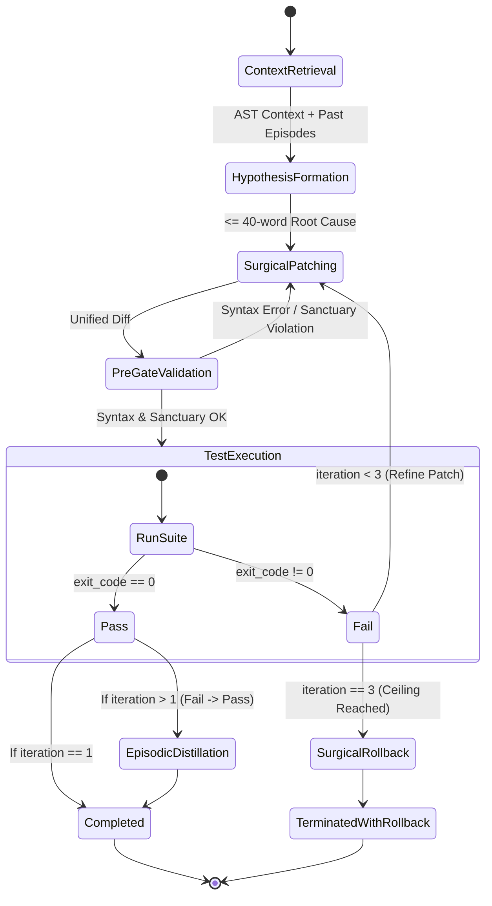

# Multi-Agent System of Working & Autonomous Orchestration Spec

**RepoBrain V2 & ResearchBrain OS**  
*Governed by Modern Autonomous Multi-Agent Practices: Role Specialization, State-Driven Transitions, Bounded Retries, and Self-Healing Loops.*

---

## 1. Multi-Agent Architecture & Role Topology

Rather than relying on a single monolithic prompt, RepoBrain orchestrates specialized, narrow-scope agents with explicit input/output data contracts:

```
                             ┌───────────────────────────────┐
                             │       User / Task Goal        │
                             └───────────────┬───────────────┘
                                             │
                                             ▼
                             ┌───────────────────────────────┐
                             │   CHIEF ARCHITECT AGENT       │
                             │  • Goal decomposition         │
                             │  • 5-Phase CoT state machine  │
                             │  • Final verdict & summary    │
                             └───────┬───────┬───────┬───────┘
                                     │       │       │
          ┌──────────────────────────┘       │       └─────────────────────────┐
          ▼                                  ▼                                 ▼
┌──────────────────┐               ┌──────────────────┐               ┌──────────────────┐
│  CODE MEMORY     │               │  RESEARCH & CRAG │               │  SENTRY & TEST   │
│  SPECIALIST      │               │  SPECIALIST      │               │  SPECIALIST      │
│  (Layer 1 & 4)   │               │  (Layer 3)       │               │  (Layer 2 & 5)   │
├──────────────────┤               ├──────────────────┤               ├──────────────────┤
│ • AST parsing    │               │ • Local ADRs/RFCs│               │ • Sanctuary guard│
│ • RRF k=60 search│               │ • Confidence >=75│               │ • Syntax checks  │
│ • SHA tracking   │               │ • 1-hop web comp.│               │ • Test runner    │
│ • Blueprint stock│               │ • Markdown cache │               │ • Distillation   │
│ • Context blocks │               │ • Grounding check│               │ • Byte rollback  │
└──────────────────┘               └──────────────────┘               └──────────────────┘
```

---

## 2. Specialized Agent Contracts

### Agent 1: Chief Architect (Orchestrator)
- **Role:** High-level coordinator, hypothesis generator, and patch synthesizer.
- **Input:** Task prompt (e.g. *"Fix decimal quantization in LedgerService.settleInvoiceById"*).
- **Duties:**
  1. Calls **Code Memory Specialist** to retrieve AST context and matching past episodes.
  2. If technical or domain concepts are uncertain, delegates to **Research & CRAG Specialist**.
  3. Formulates a $\le 40$-word diagnostic hypothesis.
  4. Synthesizes a unified diff adhering to Guardrail #1 (UTF-8 byte safety) and Guardrail #2 (decorator preservation).
  5. Delegates execution to **Sentry & Test Specialist**.
  6. Evaluates the test result: if failed and `iteration < 3`, loops back to step 3; if `iteration == 3`, confirms surgical rollback.

### Agent 2: Code Memory & Template Specialist (Layer 1 & 4)
- **Role:** Structural repository navigation and starter pattern retrieval.
- **Tools:** `search_codebase`, `search_templates`, `sync_file_if_changed`.
- **Output:** Emits clean `<ast_context>` XML blocks (parent imports + child body + past episodic fixes), ensuring token consumption remains $<600$ tokens per symbol.

### Agent 3: ResearchBrain CRAG Specialist (Layer 3)
- **Role:** Conceptual grounding and documentation retrieval.
- **Tools:** `research_technology`.
- **Output:** Evaluates local ADRs and RFCs. If confidence $\ge 0.75$, responds in 0 external tokens. If $< 0.75$, extracts top 3 dense snippets ($< 1,000$ tokens) and auto-caches them.

### Agent 4: Sentry & Test Execution Specialist (Layer 2 & 5)
- **Role:** Execution containment, static validation, test execution, and rollback.
- **Tools:** `apply_git_patch`, `run_test_suite`.
- **Invariants:**
  - Enforces `SanctuaryPolicyGuard` (blocks `.env`, `*.lock`, `../`, and test assertion weakening at `iteration = 0`).
  - Snapshots raw file bytes before disk mutation.
  - Runs fast 150ms static syntax pre-gate (`py_compile`).
  - Executes test suite with sanitized `--` flags.
  - Strips third-party frames (`site-packages/`, `node_modules/`).
  - On fail-to-pass transitions, distills normalized post-mortem into `project_episodes`.
  - On Attempt 3 failure, executes surgical byte rollback restoring exact pre-task bytes.

---

## 3. The Autonomous Self-Correction Loop



---

## 4. Multi-Agent Communication Protocol

Agents communicate over structured JSON payloads conforming to `schemas.py`. All events are recorded in an execution event trace:

```json
{
  "trace_id": "trace-uuid4",
  "task_id": "fix-settle-invoice",
  "step": 1,
  "agent": "ChiefArchitect",
  "action": "delegate_retrieval",
  "payload": {
    "query": "settleInvoiceById decimal quantization"
  },
  "timestamp": "2026-10-20T17:20:00Z"
}
```

This guarantees full determinism, observability, and auditability at every stage.

