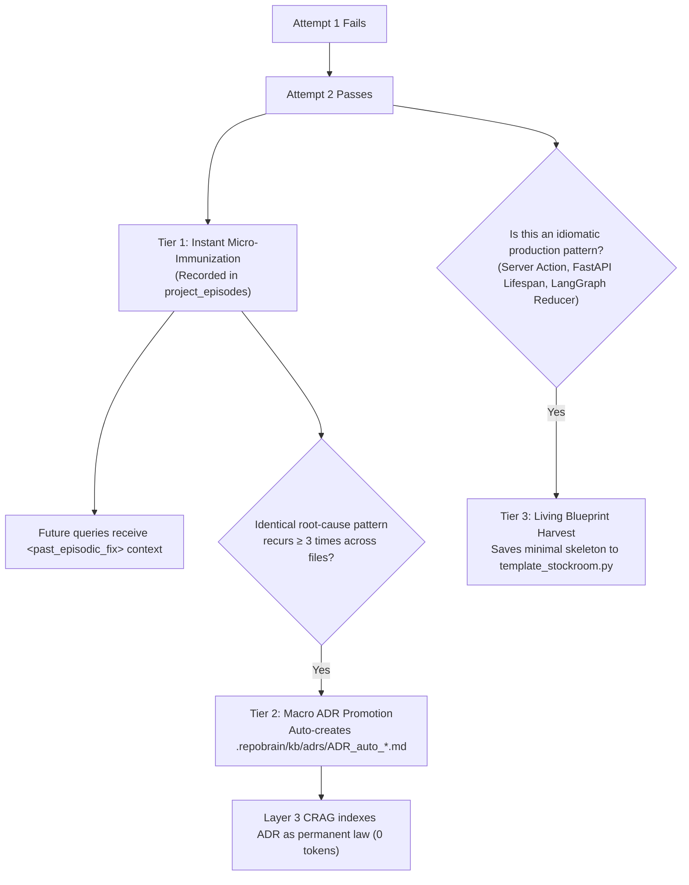

# RepoBrain V2 & ResearchBrain OS: Complete Setup & User Manual

**Autonomous Codebase Memory Engine, Self-Healing Bug Cache & Execution Harness**  
*Connecting frontier AI coding agents (Google Antigravity, Claude Code, Cursor, Windsurf) to local repositories over `stdio` FastMCP with zero context bloat and bounded execution.*

---

## 📋 Table of Contents
1. [Executive Overview & Philosophy](#1-executive-overview--philosophy)
2. [Prerequisites & Environment Setup](#2-prerequisites--environment-setup)
3. [Connecting to Google Antigravity](#3-connecting-to-google-antigravity)
4. [Connecting to Claude Code CLI](#4-connecting-to-claude-code-cli)
5. [Connecting to Cursor, Windsurf & VS Code](#5-connecting-to-cursor-windsurf--vs-code)
6. [The 6 MCP Tools Developer Reference](#6-the-6-mcp-tools-developer-reference)
7. [The 3-Tier Self-Learning Loop in Action](#7-the-3-tier-self-learning-loop-in-action)
8. [Running the Full-Stack Workbench & Interactive Academy](#8-running-the-full-stack-workbench--interactive-academy)
9. [Troubleshooting & Production Guardrails](#9-troubleshooting--production-guardrails)

---

## 1. Executive Overview & Philosophy

Most AI coding assistants struggle with three critical failure modes when applied to real-world software repositories:
1. **Context Bloat & Attention Degradation:** Reading whole 2,000-line files floods the model's context window, degrading middle-token recall and driving up token costs.
2. **Alphanumeric & Identifier Blindness:** Dense vector embeddings confuse `getUserById` with `updateUserById` or lose exact symbol names.
3. **Runaway Verification Bias & Git Tree Damage:** Models loop endlessly on failing tests, weaken assertions to pass, or execute destructive commands like `git reset --hard` that wipe uncommitted work.

### How RepoBrain Solves This
RepoBrain acts as an **in-process cognitive substrate and safety harness**:
* **Sub-Symbol AST Slicing:** Extracts exact function bodies, parent imports, and parameter types in $<500$ tokens (90% context reduction).
* **Two-Stage Hybrid RRF ($k=60$):** Fuses lexical split-token full-text search with dense vectors, reranked by CPU Cross-Encoders.
* **Bounded $\le 3$-Iteration Harness:** Pre-gates syntax via `py_compile` / `tsc`, executes tests, and performs **surgical in-memory byte rollbacks** on failure—never touching uncommitted files.
* **3-Tier Self-Learning:** Automatically learns from fail-to-pass transitions, auto-promotes recurring bugs to Architectural Decision Records (ADRs), and harvests living blueprints into a template stockroom.

---

## 2. Prerequisites & Environment Setup

### System Requirements
* **Python:** 3.10, 3.11, 3.12, 3.13, or 3.14
* **Node.js:** 18.0.0 or higher (v20+ recommended)
* **Git:** Installed and available on `PATH`

### 2.1 Clone & Install Python Dependencies
```powershell
# In repository root:
pip install -e .

# Or install core runtime dependencies:
pip install pydantic fastmcp langgraph langchain-core httpx beautifulsoup4
```

### 2.2 Install Frontend Dependencies & Build Assets
```powershell
# Install Node dependencies:
npm install

# Build static assets (creates dist/ and compiles Tailwind CSS):
npm run build
```

### 2.3 Verify System Health (Sanity Check)
Run the automated verification suite before connecting your agent:
```powershell
# 1. Run all 38 unit and integration tests:
python -m unittest discover tests

# 2. Run the 4-Gate Deterministic Stress Test:
python src/repobrain/verify_gates.py
```
Expected output:
```text
Ran 38 tests in ~5.5s — OK
ALL 4 VERIFICATION GATES DETERMINISTICALLY VERIFIED!
```

---

## 3. Connecting to Google Antigravity

RepoBrain communicates over standard Model Context Protocol (MCP) JSON-RPC on `stdio`.

### 3.1 Antigravity MCP Configuration
In your Antigravity MCP settings (e.g. `mcp_config.json` or workspace settings):

```json
{
  "mcpServers": {
    "repobrain": {
      "command": "python",
      "args": ["-m", "repobrain.server"],
      "cwd": "C:\\Users\\LV126\\Desktop\\RepoBrain",
      "env": {
        "PYTHONPATH": "src",
        "TOKENIZERS_PARALLELISM": "false",
        "HF_HUB_DISABLE_PROGRESS_BARS": "1"
      }
    }
  }
}
```

### 3.2 Verification in Antigravity
Once configured, Antigravity discovers all 6 tools automatically. You can prompt Antigravity directly:
> *"Use search_codebase to inspect how invoice settlement works, check its blast radius, and tell me which tests cover it."*

---

## 4. Connecting to Claude Code CLI

Claude Code has first-class MCP support and can use RepoBrain for both terminal pair-programming and headless automation.

### 4.1 One-Command Registration
Run this command from your terminal:
```powershell
claude mcp add repobrain -- python -m repobrain.server
```

### 4.2 Verify Registration
Check that RepoBrain is recognized and connected:
```powershell
claude mcp list
```
Expected output:
```text
repobrain: python -m repobrain.server - √ Connected
```

### 4.3 Running Claude Code with RepoBrain

#### Interactive Terminal Mode:
```powershell
claude
```
Ask Claude:
> *"What is the blast radius if I refactor LedgerService.settleInvoiceById? Use the repobrain MCP tools."*

#### Headless / Scripted Mode:
For background or non-interactive runs, pass `--dangerously-skip-permissions` so Claude doesn't pause for manual prompt confirmations:
```powershell
claude -p "Use search_codebase to find decimal quantization issues, apply a verified patch, and run tests." --dangerously-skip-permissions
```

---

## 5. Connecting to Cursor, Windsurf & VS Code

For Cursor, Windsurf, or standard VS Code MCP extensions:

### `.cursor/mcp.json` / Extension Config
```json
{
  "mcpServers": {
    "repobrain": {
      "command": "python",
      "args": ["-m", "repobrain.server"],
      "cwd": "${workspaceFolder}",
      "env": {
        "PYTHONPATH": "src",
        "TOKENIZERS_PARALLELISM": "false"
      }
    }
  }
}
```

---

## 6. The 6 MCP Tools Developer Reference

| Tool Name | Purpose | Token Footprint | Key Output Fields |
| :--- | :--- | :--- | :--- |
| **`search_codebase`** | Sub-symbol AST retrieval with 1-hop scope and past bug fixes | $< 500$ tokens | `body_code`, `imports_header`, `related_episodes`, `rrf_score` |
| **`get_blast_radius`** | Call-graph dependency impact analyzer & risk assessor | $< 300$ tokens | `callers`, `associated_tests`, `risk_level`, `advisory` |
| **`apply_git_patch`** | Bounded patch application with syntax pre-gates and rollback | Structured JSON | `patch_applied`, `static_check_passed`, `tests_passed`, `rolled_back` |
| **`run_test_suite`** | Polyglot test runner with third-party stack frame stripping | Filtered text | `exit_code`, `filtered_traceback`, `tests_passed` |
| **`research_technology`** | 5-Phase LangGraph CRAG engine over local ADRs and 1-hop docs | $< 600$ tokens | `confidence_score`, `source`, `summary_markdown`, `cited_passages` |
| **`search_templates`** | Curated & living blueprint catalog with dual advisory citations | $< 400$ tokens | `repo_name`, `symbol_name`, `stack_domain`, `code_snippet` |

### Example Tool Prompts

#### Using `search_codebase`
```text
Prompt: "Search the codebase for how invoice tax is settled."
Tool Call: search_codebase(query="settle invoice tax calculation", limit=3)
Result: Returns exact method LedgerService.settleInvoiceById wrapped in parent imports and past episodic bug fixes.
```

#### Using `get_blast_radius`
```text
Prompt: "Check the impact before modifying InvoiceRequest."
Tool Call: get_blast_radius(symbol_name="InvoiceRequest", file_path="src/billing/ledger.py")
Result: Identifies that settleInvoiceById uses this type and test_ledger.py verifies it. Returns risk_level: "HIGH".
```

#### Using `research_technology` (CRAG)
```text
Prompt: "What is the recommended Next.js 15 pattern for async route parameters?"
Tool Call: research_technology(query="Next.js 15 async route params cookies headers", domain="nextjs")
Result: Evaluates local ADRs; if missing, fetches 1-hop DuckDuckGo snippets, strips DOM/HTML, caches markdown, and returns a 300-word brief.
```

---

## 7. The 3-Tier Self-Learning Loop in Action

RepoBrain compounds intelligence as you work with it:



1. **Tier 1 (Instant Micro-Immunization):**
   * Automatically triggered whenever a test transitions from failure to pass.
   * Encapsulates `(error_signature, target_symbol, root_cause_summary, resolution_diff)`.
   * Future queries inject `<past_episodic_fix>` blocks before the agent modifies code.
2. **Tier 2 (Macro ADR Auto-Promotion):**
   * When an error pattern recurs $\ge 3$ times across different files, RepoBrain clusters the records and generates a formal Architectural Decision Record in `.repobrain/kb/adrs/`.
   * Layer 3 immediately indexes this ADR, preventing regressions project-wide.
3. **Tier 3 (Living Blueprint Harvesting):**
   * Verified code skeletons are harvested into Layer 4 Stockroom, allowing agents to scaffold new features using your exact project conventions.

---

## 7.5 CLI Reference, Real-Time Watcher & Autonomous CI Self-Healing

RepoBrain provides a complete production CLI interface for developers, CI/CD runners, and background daemons:

```powershell
# 1. Real-Time File Watcher Daemon (Background incremental AST sync, zero cold-start)
repobrain watch [--repo .] [--interval 0.5]
repobrain watch --once   # One-shot incremental scan and sync

# 2. Autonomous CI & Test Self-Healing Bot
repobrain heal tests/test_payment.py [--target-file src/payment.py] [--max-iterations 3] [--output-file report.md]

# 3. Static Blast Radius & Call Graph Analysis
repobrain blast-radius compute_git_blob_sha [--file src/repobrain/ast_chunker.py]

# 4. Quantitative Token Compression & Speed Benchmarks
repobrain benchmark

# 5. Hybrid Search (Two-Stage RRF k=60 + Dense Cross-Encoder)
repobrain search "settleInvoiceById" --top-k 5

# 6. 5-Phase CRAG Research Engine
repobrain research "LangGraph multi-agent supervisor patterns" --domain agentic_ai

# 7. Template Stockroom Blueprint Scaffolding
repobrain templates "Polars DataAnalyticsPipeline" --domain data_science
repobrain templates "LangGraph MultiAgentSupervisor" --domain agentic_ai
repobrain templates "CleanHexagonalPorts" --domain clean_architecture

# 8. 4-Gate Deterministic Stress Test
repobrain verify

# 9. Multi-Agent Local Swarm Mesh (LangGraph Native)
repobrain swarm "Fix payment precision bug" [--target-file src/service.py] [--test-path tests/test_service.py] [--max-iterations 3]
```

### Autonomous GitHub Actions CI Self-Healing
RepoBrain includes `.github/workflows/repobrain-heal.yml` for automated PR remediation:
1. When a PR test fails in CI, RepoBrain catches the error signature and local stack trace.
2. It analyzes the blast radius of the failing symbol to map affected callers and test suites.
3. It checks Layer 2 episodic memory for past post-mortems matching the bug signature.
4. It applies bounded surgical patches ($\le 3$ retries) with strict non-destructive rollback.
5. It posts a structured, formatted post-mortem comment on the GitHub PR.

---

## 7.6 Agentic AI, Data Science & Clean Architecture Intelligence

RepoBrain natively understands and scaffolds modern high-performance stacks:

1. **Agentic AI & LangGraph StateGraphs (`agentic_ai`):**
   - AST extraction recognizes `TypedDict` agent state schemas, `@tool` decorators, and LangGraph `StateGraph` workflows.
   - Pre-seeded ADR: `ADR_agentic_ai_langgraph.md` (StateGraph vs linear chains, supervisor routing, human-in-the-loop review).
   - Blueprint: `LangGraph.MultiAgentSupervisor` for coordinated multi-agent swarms.

2. **Data Science & Analytics Pipelines (`data_science`):**
   - AST extraction parses Polars streaming pipelines, Pandas DataFrames, and PyTorch `nn.Module` neural architectures.
   - Pre-seeded ADR: `ADR_data_science_analytics.md` (Polars LazyFrame vs Pandas eager evaluation, zero-copy streaming, batched PyTorch GPU inference).
   - Blueprint: `Polars.DataAnalyticsPipeline` and `PyTorch.InferenceService`.

3. **Modern App Development & Clean Architecture (`clean_architecture`):**
   - AST extraction classifies Abstract Base Classes (`ABC`), Protocols, and `@dataclass` domain entities alongside their methods.
   - Pre-seeded ADR: `ADR_clean_coding_principles.md` (Hexagonal Ports & Adapters, SOLID boundary enforcement, Dependency Inversion).
   - Blueprint: `Architecture.CleanHexagonalPorts`.

---

## 7.7 One-Click VS Code, Cursor & Windsurf Extension

RepoBrain includes a zero-dependency editor extension in `vscode-extension/` providing seamless developer ergonomics:

### Core Capabilities
* **⚡ Live Static Blast Radius CodeLens:** Attaches clickable annotations directly above functions and classes in Python and TypeScript/JavaScript. Hover or click to see dependent callers, risk levels, and associated test suites.
* **🔧 1-Click Autonomous CI Self-Healing (`repobrain.healTest`):** Runs the CI self-healing bot directly from the editor, automatically diagnosing test failures, consulting episodic memory, and applying verified fixes.
* **🐝 Multi-Agent Swarm Dispatch (`repobrain.swarmTask`):** Dispatches LangGraph autonomous teams (Architect $	o$ Coder $	o$ Tester $	o$ Supervisor) on natural language tasks.
* **🌐 Real-Time Status Bar:** Displays RepoBrain engine status with 1-click access to the local React Workbench (`http://localhost:5173`).

### Compiling the Extension
```powershell
# Compile both the React workbench and the VS Code extension:
npm run build:all

# Or compile the extension individually:
npm run build:extension
```

To sideload into VS Code, Cursor, or Windsurf: open the `vscode-extension/` directory in VS Code and press `F5` to launch an Extension Development Host, or run `npx vsce package` to produce a `.vsix` file.

---

## 8. Running the Full-Stack Workbench & Interactive Academy

RepoBrain includes a dark-mode React workbench with 8 tabs, including an interactive CTO Masterguide:

### 8.1 Start the Servers
Open two terminals in the repository root:

```powershell
# Terminal 1: Start the Express Bridge Controller (Port 3001)
node server.js

# Terminal 2: Start the Vite UI (Port 5173)
npm run dev
```

### 8.2 Using the Workbench
Open your browser to `http://localhost:5173`:
* **Tab 1: 4-Gate Verification:** Click "Run 4-Gate Stress Test" to see live deterministic AST slicing, RRF calculation, episodic self-healing, and surgical rollback.
* **Tab 2: Masterguide & Docs:** Interactive 15-module study academy. Includes a reading depth toggle (Beginner $\to$ Senior $\to$ CTO), live UTF-8 byte slicer simulator, and an 8-question self-assessment test.
* **Tab 3: 3-Layer Architecture:** Interactive interactive system topology.
* **Tab 4: AST Explorer & UTF-8:** Inspect parent-child AST decomposition.
* **Tab 5: Hybrid RRF Calculator:** Step-by-step $k=60$ mathematical scoring.
* **Tab 6: Harness Simulator:** 5-phase CoT retry and surgical rollback sandbox.
* **Tab 7: Episodic Memory:** Live view of learned bug post-mortems.
* **Tab 8: Prototype Source & SQL:** Direct inspection of production PostgreSQL DDL and schemas.

---

## 9. Troubleshooting & Production Guardrails

### Guardrail #8: stdio Protocol Hygiene
* FastMCP strictly requires that `sys.stdout` is reserved exclusively for JSON-RPC messages.
* **Never** use `print()` in server-side Python modules. All logging must use `logger.info()` or write to `sys.stderr`.
* Environment variables `TOKENIZERS_PARALLELISM="false"` and `HF_HUB_DISABLE_PROGRESS_BARS="1"` are enforced on server startup.

### Sanctuary Policy Violations
If an agent attempts to edit protected files:
```text
SanctuaryPolicyError: 'package-lock.json' matches protected pattern '*.lock'
```
* **Solution:** Modify permissions in `.repobrain/policy.toml` if you explicitly intend to allow mutations to specific files.
* Test assertion weakening is strictly rejected on Attempt 0 to prevent cheating agents.

### Surgical Byte Rollback vs `git reset --hard`
* If a task reaches Retry Ceiling #3 without passing tests, RepoBrain restores **only the files snapshotted in memory before that task began**.
* Uncommitted developer work in dirty untouched files is **never deleted or modified**.

---

## 10. Multi-Agent Integration Quick Reference

RepoBrain functions as a standard FastMCP server over `stdio`. It connects identically across modern AI agent environments:

| Agent Host | Configuration Location / Command | Transport |
| :--- | :--- | :--- |
| **Google Antigravity (AGY)** | `~/.gemini/config/mcp_config.json` or `.agents/plugins/repobrain/` | `stdio` |
| **Anthropic Claude Code** | `claude mcp add repobrain -- python -m repobrain.server` or `.claude/mcp.json` | `stdio` |
| **OpenAI Codex / Cursor** | `~/.cursor/mcp.json` (`mcpServers.repobrain`) | `stdio` |
| **Codeium Windsurf** | `~/.codeium/windsurf/mcp_config.json` | `stdio` |

For full benchmarks, token compression ratios, and cross-agent compounding memory verification, see [07_AGENT_INTEGRATION_AND_EVALUATION_REPORT.md](./07_AGENT_INTEGRATION_AND_EVALUATION_REPORT.md).

---

*Authored by the RepoBrain Systems Engineering Team • October 2026*

